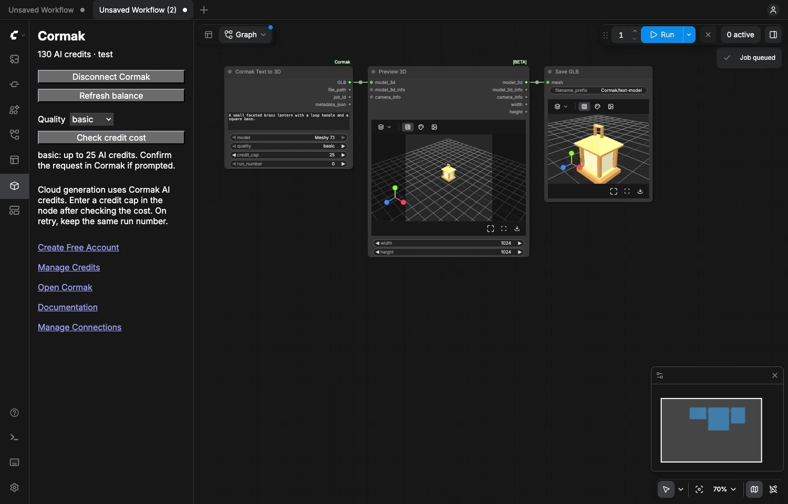

# Cormak Nodes

Text to 3D and Image to 3D in ComfyUI, powered by your existing **Cormak** account.
Generate a textured GLB asset, preview it and reuse it in a 3D workflow.

**Release status:** 0.1.0 released. The package is published in the Comfy
Registry and can be installed through ComfyUI Manager. Production login and
paid generation remain outside the local fixture QA described below.



## Requirements and installation

- ComfyUI **0.45.0**, frontend **1.58.5** or a compatible newer version.
- Python 3.11+ and the dependencies already provided by ComfyUI: aiohttp,
  Pillow and PyTorch. The package installs no additional runtime dependencies.
- A private, single-user ComfyUI instance and internet access to Cormak.
  No local model weights, GPU, Meshy API key or separate Cormak account is needed.
- Windows, macOS and Linux use the same Python code. The release candidate has
  been exercised on macOS; see [verification](docs/VERIFICATION.md) for actual coverage.

Copy this directory to `ComfyUI/custom_nodes/ComfyUI-Cormak` and restart ComfyUI.
After publication, install **Cormak Nodes** through ComfyUI Manager instead.

Open the **Cormak** sidebar. Choose **Connect Cormak**, sign in or register on
Cormak, allow all three permissions, and return to ComfyUI. The panel displays
your balance. Passwords are entered only on Cormak.

## Generate your first GLB

1. Drag [text-to-3d.json](workflows/text-to-3d.json) into ComfyUI.
2. In the Cormak sidebar choose a quality and **Check credit cost**.
3. Set the node's `credit_cap` to the maximum cost you accept. Its default, zero,
   cannot start a paid generation.
4. Enter a 10–600 character description and run the workflow.
5. If approval is required, open the job's link in the sidebar and approve the
   exact request on Cormak. Run the **same workflow with the same run_number**.
6. Inspect the model in **Preview 3D (Advanced)**. **Save 3D Model** writes it to
   ComfyUI's output directory. **Cormak 3D Result** also saves the original GLB
   without format conversion.

For [image-to-3d.json](workflows/image-to-3d.json), choose a reference with the
standard **Load Image** node. One RGB IMAGE of shape `[1,H,W,3]` is supported.
Batches are rejected so that one run cannot silently start multiple paid jobs.
The image is resized proportionally to at most 1600 pixels and encoded as JPEG
before upload; do not rely on it for original-resolution image archival.

## Nodes

All five nodes are in category **Cormak**.

| Node | Purpose | Outputs |
| --- | --- | --- |
| Cormak Text to 3D | Describe an object and choose quality, credit cap and run number | FILE3DGLB, local file path, job ID, JSON receipt |
| Cormak Image to 3D | Generate from one standard Comfy IMAGE | Same outputs |
| Cormak 3D Result | Fetch an existing job and save its original GLB in `output/Cormak` | Same outputs |
| Cormak Account | Read the connection, plan and shared AI credit balance | Status, balance, plan, account links |
| Cormak Generation Status | Check a job without submitting another generation | Job ID, status, progress, JSON receipt |

The current Cormak API exposes one 3D model, **Meshy 7.1**, with `basic`, `medium`
and `high` quality presets. The server's quote is authoritative. The credit cap is
an upper bound; discounts can lower the final charge. Cormak handles reservation,
charging, failed generation refunds, moderation and ownership checks.

The generator nodes download their result to ComfyUI's temporary directory.
Use a save node for a permanent copy. The returned metadata excludes prompts,
images, tokens and private signed download URLs. A GLB can contain generated
materials and textures embedded in the file.

## Retries and intentional regeneration

Keep `run_number` unchanged after an interruption, network failure, approval or
download failure. A local durable journal reuses the original UUID. The backend
also enforces idempotency. Unchanged inputs and run number reuse the job rather
than purchase a second result; Comfy's cache is never used as authorization.

To deliberately purchase a different generation for identical inputs, change
`run_number`. Changing the input, image or quality also creates a new request.
Review the cost first. Different generator nodes with identical inputs and run
number intentionally share one job.

The journal is in `ComfyUI/user/cormak_nodes/requests.sqlite3`. Keep this file and
the browser's Cormak cookie when moving or restarting an installation.
Deleting them, switching browsers, or moving to a different server loses local
retry identity. Check your Cormak history before requesting a new generation.

After a restart or reconnect, a server-known job can be resumed. An old intent
that the current connection cannot find is blocked instead of automatically
submitted. For recovery, use its original account/connection and job ID.
Queued jobs are bound to the browser session present at submission; after
disconnect/reconnect, requeue them. Jobs queued for over 12 hours must be requeued.

Polling stops after 15 minutes. Retry the same workflow or use Generation Status.
ComfyUI's interrupt stops waiting; the API has no server-side cancel, so it does
not cancel a cloud job that Cormak already accepted.

## 3D compatibility

This candidate targets the native ComfyUI 0.45.0 `FILE3DGLB` type and
`comfy_api.latest.Types.File3D`.

Verified built-in chains are:

- **Cormak Text to 3D → Preview 3D (Advanced) → Save 3D Model**
- **Load Image → Cormak Image to 3D → Preview 3D (Advanced) → Save 3D Model**
- **Generation Status → Cormak 3D Result → Get 3D Components → Save 3D Model**

The last chain is [generate-and-reuse.json](workflows/generate-and-reuse.json).
Paste the original Cormak job ID into Generation Status. Get 3D Components
converts the file into a native `MESH` for compatible downstream processing.
ComfyUI labels these built-in 3D APIs experimental. Mesh conversion can change
materials, textures or mesh structure; save the original GLB first. Compatibility
with arbitrary third-party nodes, older Preview3D nodes or other Comfy releases
is not promised.

## Remote servers and security

Use a dedicated ComfyUI instance bound to loopback. For a remote host, either:

- Use an SSH port forward and open ComfyUI at `http://127.0.0.1:8188`. The OAuth
  return travels through the tunnel.
- Put an authenticated private HTTPS proxy in front of the loopback server.
  Set `CORMAK_PUBLIC_ORIGIN=https://comfy.example.com` on the server. Use a bare
  HTTPS origin without a path, port, trailing slash, credentials or query.
  Preserve its Host header when forwarding requests.

The nodes refuse public binds, `--multi-user`, offline mode, unexpected origins
and non-loopback backend connections. ComfyUI profiles alone are not an access
control boundary: the core server shares its queue, history and files. This
package does not turn a shared public ComfyUI server into a tenant-isolated service.

OAuth uses PKCE S256, a one-use state bound to an HttpOnly SameSite cookie,
an exact callback URI and the public Cormak client registration endpoint.
There is no client secret or token input. Tokens live only in server memory;
refresh is serialized and an ambiguous rotation is never replayed.
**Disconnect Cormak** attempts revocation and always clears local tokens. If it
cannot confirm revocation, follow its link to revoke access in Cormak.
Reconnecting after process exit is required. Other locally installed custom
nodes and the machine administrator are part of the trusted server environment.

Downloads are restricted to Cormak's private model bucket, without sending the
OAuth bearer. Redirects, compressed bodies, external GLB resources and files over
100 MB are rejected. Saved filenames are sanitized and unique; existing files
are never replaced.

## Privacy and account links

Generation sends the selected text or image to Cormak for cloud processing.
There are no background telemetry requests, tracking pixels, analytics SDKs or
automatic website visits. Account links contain disclosed UTM source parameters.
Cormak's existing service audit records API calls; its website may record
acquisition under its own privacy settings.

- [Create Free Account](https://app.cormak.app/3d?utm_source=comfyui&utm_medium=integration&utm_campaign=cormak_nodes&utm_content=create_account)
- [Manage Credits](https://app.cormak.app/billing?utm_source=comfyui&utm_medium=integration&utm_campaign=cormak_nodes&utm_content=manage_credits)
- [Open Cormak](https://cormak.app/?utm_source=comfyui&utm_medium=integration&utm_campaign=cormak_nodes)
- [Manage Connections](https://app.cormak.app/mcp)
- [Cormak documentation](https://cormak.app/blog/create-3d-model-with-ai)
- [Security and privacy details](docs/SECURITY.md)

## Development and publication

[Verification](docs/VERIFICATION.md), [Registry publication](docs/PUBLISHING.md)
and [listing draft and research](docs/LISTING.md).

From this directory, using the same Python environment as a separate ComfyUI:

```sh
python tests/run.py /absolute/path/to/ComfyUI
python tests/serve_fixture.py /absolute/path/to/ComfyUI /absolute/path/to/qa-scratch
```

The fixture runs on loopback port 8189 and substitutes only Cormak's network
transport. It uses sample geometry and never spends real credits. Its tests are
not evidence of production OAuth or provider quality.

MIT license covers this integration. Cormak's server source and service are
separate; no backend business logic or credentials are included.
